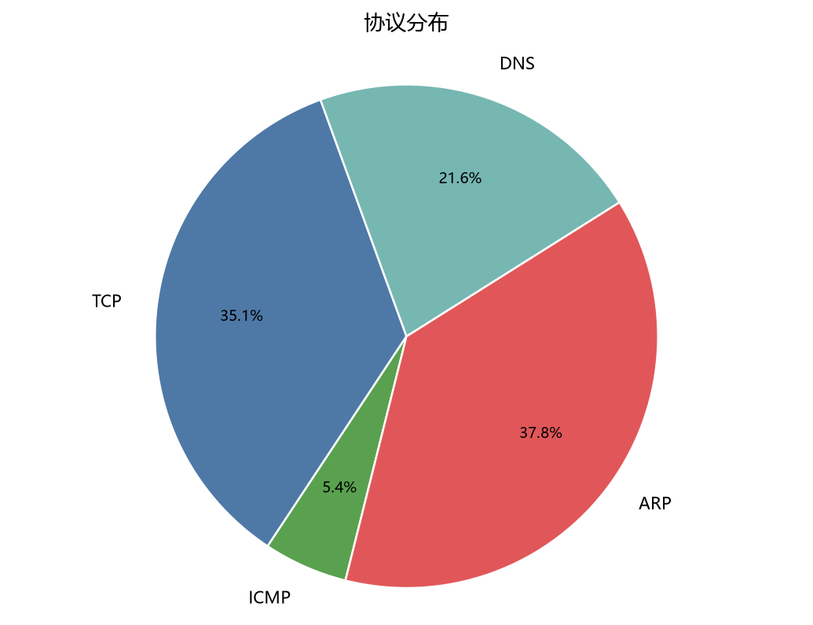
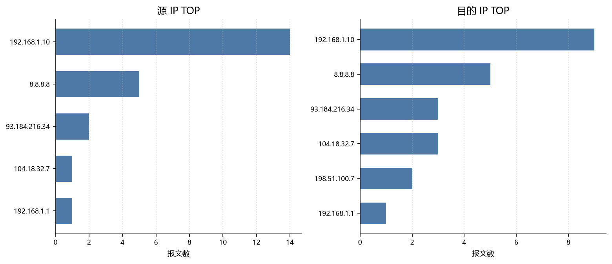

# 流量分析报告

生成时间：2026-11-09 13:13:51　｜　分析对象：`test_pcaps\sample_mixed.pcap`

> 本工具面向离线 pcap 复盘与学习，检测规则为启发式判断，结论仅供排错参考，不替代专业 IDS/流量审计系统。

## 一、抓包概览

| 项目 | 值 |
| --- | --- |
| 抓包文件 | sample_mixed.pcap |
| 文件大小 | 3.42 KB |
| 开始时间 | 2025-11-07 15:20:00 |
| 结束时间 | 2025-11-07 15:20:43 |
| 抓包时长 | 43.00 s |
| 总报文数 | 37 |
| 总字节数 | 2883 (2.82 KB) |
| 平均速率 | 0.86 包/秒，536.37 bps |

## 二、协议分布

| 协议 | 报文数 | 占比 | 字节数 |
| --- | --- | --- | --- |
| TCP | 13 | 35.14% | 1.38 KB |
| ICMP | 2 | 5.41% | 104 B |
| ARP | 14 | 37.84% | 588 B |
| DNS | 8 | 21.62% | 775 B |



## 三、流量 TOP 统计

### 源 IP TOP10

| 源 IP | 报文数 | 发送字节 |
| --- | --- | --- |
| 192.168.1.10 | 14 | 906 B |
| 8.8.8.8 | 5 | 521 B |
| 93.184.216.34 | 2 | 760 B |
| 104.18.32.7 | 1 | 54 B |
| 192.168.1.1 | 1 | 54 B |

### 目的 IP TOP10

| 目的 IP | 报文数 | 接收字节 |
| --- | --- | --- |
| 192.168.1.10 | 9 | 1.36 KB |
| 8.8.8.8 | 5 | 358 B |
| 93.184.216.34 | 3 | 213 B |
| 104.18.32.7 | 3 | 173 B |
| 198.51.100.7 | 2 | 108 B |
| 192.168.1.1 | 1 | 54 B |



### 会话 TOP10（按字节排序）

| 协议 | 源 | 目的 | 报文数 | 字节数 |
| --- | --- | --- | --- | --- |
| TCP | 93.184.216.34:80 | 192.168.1.10:50123 | 2 | 760 B |
| UDP | 8.8.8.8:53 | 192.168.1.10:53100 | 4 | 469 B |
| UDP | 192.168.1.10:53100 | 8.8.8.8:53 | 4 | 306 B |
| TCP | 192.168.1.10:50123 | 93.184.216.34:80 | 3 | 213 B |
| TCP | 192.168.1.10:50555 | 104.18.32.7:443 | 3 | 173 B |
| TCP | 192.168.1.10:52000 | 198.51.100.7:22 | 2 | 108 B |
| TCP | 104.18.32.7:443 | 192.168.1.10:50555 | 1 | 54 B |
| TCP | 192.168.1.10:51000 | 192.168.1.1:8080 | 1 | 54 B |
| TCP | 192.168.1.1:8080 | 192.168.1.10:51000 | 1 | 54 B |

### 目的端口 TOP10

| 协议/端口 | 报文数 |
| --- | --- |
| UDP/53 | 4 |
| UDP/53100 | 4 |
| TCP/80 | 3 |
| TCP/443 | 3 |
| TCP/50123 | 2 |
| TCP/22 | 2 |
| TCP/50555 | 1 |
| TCP/8080 | 1 |
| TCP/51000 | 1 |

## 四、TCP 连接概况

| 指标 | 数值 |
| --- | --- |
| 跟踪到的 TCP 流 | 4 |
| 发起 SYN 的流 | 4 |
| 完成三次握手的流 | 2 |
| SYN 无应答的流 | 1 |
| 出现 RST 的流 | 1 |
| RST 报文总数 | 1 |
| SYN 报文数 | 7 |
| FIN 报文数 | 0 |

> “SYN 无应答”可能是对端关闭端口、防火墙丢包或链路不可达，也可能只是抓包位置看不到回包，需结合抓包点判断。

## 五、DNS 解析概况

| 指标 | 数值 |
| --- | --- |
| DNS 查询报文 | 4 |
| DNS 应答报文 | 4 |
| 出现过的查询域名 | 3 |
| 有 A/AAAA 应答的域名 | 3 |
| 解析到多个 IP 的域名 | 2 |

### 解析结果域名 TOP10

| 域名 | 解析 IP 数 | IP 样本 |
| --- | --- | --- |
| cdn.demo-site.com | 2 | 104.18.32.7、104.18.33.9 |
| www.bank-demo.com | 2 | 203.0.113.20、45.77.20.99 |
| www.example.com | 1 | 93.184.216.34 |

## 六、异常检测结果

共命中 **4** 条：高 1 条、中 2 条、低 1 条。

### 1. [高] IP 192.168.1.1 出现多个 MAC 映射

- 类型：ARP　规则：`arp_ip_mac_conflict`
- 说明：抓包中共有 2 个 MAC 声称自己是 192.168.1.1，合计 9 次 ARP 报文。正常情况下同一 IP 应只对应一个 MAC，多 MAC 并存是 ARP 欺骗（中间人/网关冒充）的典型特征。
- 证据：de:ad:be:ef:00:66（5 次），aa:bb:cc:00:11:01（4 次）
- 建议：先确认是否做过网关迁移或网卡更换；否则对比交换机 ARP 表与真实终端 MAC 定位来源。

### 2. [中] MAC de:ad:be:ef:00:66 声明了 5 个不同 IP

- 类型：ARP　规则：`arp_mac_multi_ip`
- 说明：单个 MAC 在 ARP 报文中声明多个 IP，可能是 ARP 扫描、伪造应答，也可能是 DHCP 频繁续租或代理 ARP 的正常行为，需要结合时间线判断。
- 证据：192.168.1.1、192.168.1.20、192.168.1.30、192.168.1.40、192.168.1.50
- 建议：对照 DHCP 租约记录与交换机端口 MAC 表，确认该 MAC 是否长期对应单一主机。

### 3. [中] 域名 www.bank-demo.com 出现 2 个解析结果，涉及 2 个网段

- 类型：DNS　规则：`dns_multi_ip`
- 说明：域名 www.bank-demo.com 在同一份抓包里解析到 2 个 IP，且分布在 2 个不同 /16 网段。同一域名短时间返回跨网段的不同地址，可能是 DNS 劫持、缓存投毒或投毒式负载均衡；但大型 CDN 也会返回多地域节点地址，需结合 TTL 与请求时间点排除误报。
- 证据：应答记录 2 条；IP：203.0.113.20、45.77.20.99
- 建议：用 dig 多次查询对比权威 DNS 结果，并检查本地 DNS 服务器与网关配置是否被篡改。

### 4. [低] 域名 cdn.demo-site.com 出现 2 个解析结果，涉及 1 个网段

- 类型：DNS　规则：`dns_multi_ip`
- 说明：域名 cdn.demo-site.com 解析到 2 个不同 IP（同一 /16 网段内）。多 A 记录本身常见于负载均衡场景，仅作为备案式提示，不构成告警。
- 证据：应答记录 2 条；IP：104.18.32.7、104.18.33.9
- 建议：用 dig 多次查询对比权威 DNS 结果，并检查本地 DNS 服务器与网关配置是否被篡改。

## 七、复现方式

```bash
python main.py sample_mixed.pcap -o report.md
```

## 八、说明与免责

- 解析基于 Scapy 读取链路层帧，协议分类优先级：ARP > DNS > TCP > UDP > ICMP > 其他；
- 当前检测规则共 2 类：ARP 的 IP-MAC 冲突/单 MAC 多 IP、DNS 的多 IP 跨网段解析；
- 规则为学习型启发式判断，存在误报（如 CDN、代理 ARP、网关迁移），不构成入侵取证结论；
- 仅用于离线分析自己有权抓取的流量，禁止对公网或他人网络抓包探测。
